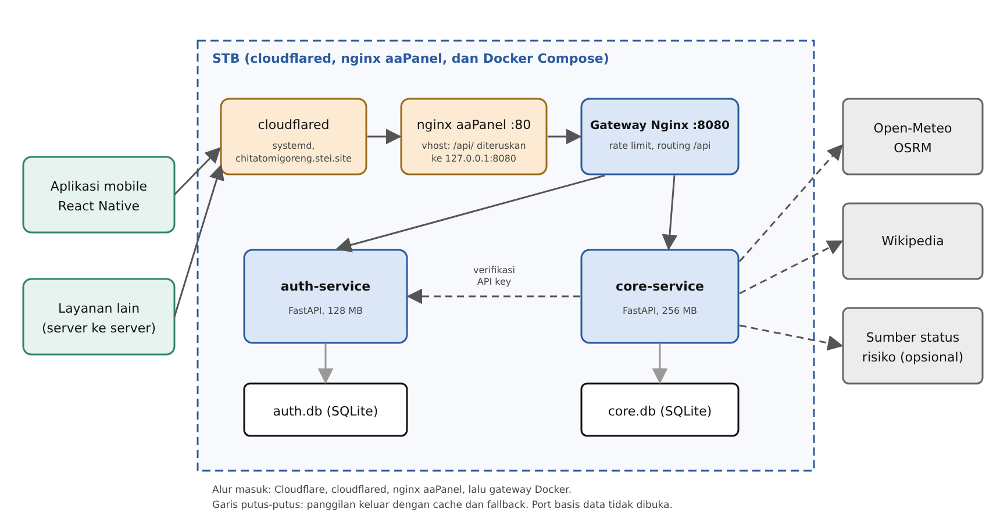

# JelajahLokal: Layanan Wisata Tersembunyi dan Cerita Budaya

Tugas Besar II3160 Teknologi Sistem Terintegrasi x II3140 Pengembangan Aplikasi Web dan Mobile, Tugas 2 (microservice di STB).
Kelompok chitato mi goreng: Firanti Naulia Fasya (18224119) dan Rachel Elnora Mannuelle S (18224125).

- **Base URL:** `https://chitatomigoreng.stei.site/api`
- **Dokumentasi interaktif (Swagger):** `https://chitatomigoreng.stei.site/api/docs`
- **Kontrak OpenAPI:** `docs/openapi-core.yaml` (layanan inti) dan `docs/openapi-auth.yaml` (login dan API key)
- **Makalah DDD:** model domain, bounded context, dan subdomain yang diimplementasikan di sini

## 1. Ringkasan

JelajahLokal menyediakan API untuk menemukan destinasi wisata tersembunyi di Bandung Raya dan Jawa Barat, membaca cerita budayanya, menulis ulasan, menyusun rencana kunjungan, dan melihat cuaca, status risiko, serta rute menuju destinasi. Destinasi dan cerita dikirim kontributor lokal dan diterbitkan admin. Destinasi dengan ulasan kurang dari 5 ditandai `hidden_gem`. Data destinasi yang sudah terbit dibuka bagi layanan lain lewat `GET /api/feed/destinations`.

## 2. Arsitektur



| Kontainer | Peran | Batas sumber daya |
|---|---|---|
| `gateway` (Nginx) | Satu-satunya pintu masuk: routing `/api` dan `/api/auth`, pembatasan pemanggilan (10 permintaan/detik per IP, login 5/menit), memblokir `/api/auth/internal` | 64 MB, 0,25 CPU |
| `core` (FastAPI) | Lima bounded context bisnis sebagai modul, basis data SQLite `core.db` | 256 MB, 0,5 CPU |
| `auth` (FastAPI) | Bounded context Identitas dan Akses: akun, JWT, API key; SQLite `auth.db` | 128 MB, 0,25 CPU |

Semua kontainer memakai `restart: unless-stopped`. Basis data berada di volume Docker dan tidak membuka port ke jaringan. Frontend, build aplikasi mobile, dan model AI tidak berjalan di STB.

### Bounded context dan modul

| Bounded context (makalah) | Modul | Event yang diterbitkan |
|---|---|---|
| Katalog Destinasi | `modules/destinations.py` | `DestinasiTerbit`, `DestinasiDiperbarui` |
| Cerita Budaya | `modules/stories.py` | `CeritaTerbit` |
| Ulasan Pengunjung | `modules/reviews.py` | `UlasanDitambahkan`, `UlasanDimoderasi` |
| Rencana Kunjungan | `modules/plans.py` | tidak ada |
| Kondisi Sekitar Destinasi | `modules/conditions.py` dan `adapters/` | tidak ada |
| Umpan Destinasi | `modules/feed.py` | tidak ada |
| Identitas dan Akses | `auth-service` (kontainer sendiri) | tidak ada |

Antar-modul berkomunikasi lewat domain event sinkron (`events.py`, `handlers.py`). Contohnya, `UlasanDitambahkan` memicu penghitungan ulang rating dan penanda `hidden_gem` pada destinasi, dan `CeritaTerbit` memperbarui `story_count`. Modul hilir tidak membaca tabel modul hulu.

### Sumber luar

| Sumber | Dipakai untuk | Jika gagal |
|---|---|---|
| Open-Meteo | Cuaca saat ini atau prakiraan tanggal tertentu | Data terakhir tersimpan dikembalikan dengan `stale: true`; jika belum ada, pesan keterangan |
| OSRM | Rute mobil ke destinasi | Data tersimpan, atau HTTP 503 dengan pesan jelas |
| Wikipedia (id) | Ringkasan latar sejarah (`/background`) | Data tersimpan, atau HTTP 503 |
| Sumber status risiko wilayah (opsional) | Tingkat risiko `safe`, `caution`, atau `danger` | `risk_level: null` dengan keterangan di message; endpoint lain tetap berfungsi |

Sumber status risiko dikonfigurasi lewat `RISK_API_URL`, `RISK_API_KEY`, dan `RISK_LEVEL_FIELD` di `.env`. Adapter menerjemahkan istilah sumber (misalnya `green`, `kuning`, `high`) ke safe, caution, atau danger, sehingga sumber dapat diganti tanpa mengubah kode. Semua pemanggilan memakai User-Agent yang jelas dan cache dengan TTL.

## 3. Cara mendapat akses

| Pemanggil | Autentikasi | Cara mendapatkan |
|---|---|---|
| Pengguna aplikasi | `Authorization: Bearer <JWT>` | `POST /api/auth/register` lalu `POST /api/auth/login` (JWT berlaku 12 jam) |
| Layanan lain (server ke server) | `X-API-Key: <key>` | Minta ke admin; admin membuat lewat `POST /api/auth/api-keys` dan key hanya tampil sekali. Dapat dicabut kapan saja. |
| Pengunjung anonim | Tanpa autentikasi | Pencarian, detail, cerita, ulasan, dan kondisi terbuka, tetapi dibatasi jumlah pemanggilannya |

**Akun uji** (data uji, bukan data pribadi asli): `wisatawan@demo.test` dan `kontributor@demo.test` dengan password sesuai `DEMO_PASSWORD` di `.env` (bawaan `demo123`), serta satu API key uji sesuai `SEED_API_KEY`. Peran di API dan JWT: `tourist`, `contributor`, dan `admin`. Akun admin dibuat dari `ADMIN_EMAIL` dan `ADMIN_PASSWORD`. Pendaftaran publik hanya dapat membuat `tourist` atau `contributor`.

Pencabutan API key berlaku paling lambat 60 detik karena core menyimpan hasil verifikasi sebentar.

## 4. Daftar endpoint

### Layanan inti (`/api`)

| Metode | Path | Fungsi | Akses |
|---|---|---|---|
| GET | `/api/destinations` | Cari destinasi | Publik |
| POST | `/api/destinations` | Kirim destinasi baru (kontributor) | JWT kontributor/admin |
| GET | `/api/destinations/{id}` | Detail destinasi | Publik (pemilik/admin untuk yang belum terbit) |
| PATCH | `/api/destinations/{id}/status` | Terbitkan atau tolak destinasi (admin) | JWT admin |
| GET | `/api/destinations/{id}/stories` | Daftar cerita sebuah destinasi | Publik |
| GET | `/api/destinations/{id}/background` | Ringkasan latar sejarah (Wikipedia) | Publik |
| GET | `/api/stories` | Daftar cerita (admin dapat memfilter status) | Publik (admin: filter status) |
| POST | `/api/stories` | Kirim cerita budaya (kontributor) | JWT kontributor/admin |
| GET | `/api/stories/{id}` | Isi cerita | Publik |
| PATCH | `/api/stories/{id}/status` | Terbitkan atau tolak cerita (admin) | JWT admin |
| GET | `/api/destinations/{id}/reviews` | Daftar ulasan dan rata-rata rating | Publik |
| POST | `/api/destinations/{id}/reviews` | Tulis ulasan (login) | JWT (semua peran) |
| POST | `/api/reviews/{id}/report` | Laporkan ulasan untuk ditinjau (login) | JWT (semua peran) |
| GET | `/api/reviews/reported` | Ulasan yang dilaporkan (admin) | JWT admin |
| PATCH | `/api/reviews/{id}/moderation` | Sembunyikan atau tampilkan ulasan (admin) | JWT admin |
| GET | `/api/plans` | Rencana kunjungan milik saya | JWT |
| POST | `/api/plans` | Simpan destinasi dan tanggal kunjungan | JWT |
| DELETE | `/api/plans/{id}` | Hapus rencana kunjungan | JWT |
| GET | `/api/destinations/{id}/conditions` | Cuaca dan status risiko di sekitar destinasi | Publik |
| GET | `/api/destinations/{id}/route` | Rute mobil menuju destinasi | Publik |
| GET | `/api/feed/destinations` | Umpan destinasi terbit untuk layanan lain (X-API-Key) | X-API-Key |
| GET | `/api/health` | Cek layanan hidup | Publik |

Parameter pencarian `GET /api/destinations`: `q`, `category` (`nature`, `culture_history`, `local_culinary`, `tourism_village`, `craft`), `hidden`, `lat` dan `lon` (bersama), `radius_m` (meter), `status` (admin: `waiting`, `published`, `rejected`), `mine`, `limit` (bawaan 50, maksimum 200), `offset`. Jika `lat` dan `lon` diberikan, hasil diurutkan menurut jarak dan memuat `distance_m` (meter). Kutipan singkat cerita: `GET /api/stories/{id}?mode=short`. Prakiraan tanggal tertentu: `GET /api/destinations/{id}/conditions?date=YYYY-MM-DD` (maksimal 14 hari). Status destinasi dan cerita: `waiting` ke `published` atau `rejected` (alasan wajib untuk `rejected`).

### Login dan API key (`/api/auth`)

| Metode | Path | Fungsi | Akses |
|---|---|---|---|
| GET | `/api/auth/health` | Cek layanan hidup | Publik |
| POST | `/api/auth/register` | Daftar akun wisatawan atau kontributor | Publik |
| POST | `/api/auth/login` | Login, mengembalikan JWT | Publik (dibatasi 5/menit) |
| GET | `/api/auth/me` | Profil pengguna yang sedang login | JWT |
| POST | `/api/auth/api-keys` | Buat API key (admin) | JWT admin |
| GET | `/api/auth/api-keys` | Daftar API key (admin) | JWT admin |
| DELETE | `/api/auth/api-keys/{id}` | Cabut API key (admin) | JWT admin |

Endpoint `/api/auth/internal/*` hanya untuk komunikasi core ke auth dan ditolak oleh gateway.

## 5. Format respons dan contoh request

Semua respons sukses dibungkus `{"data": ..., "meta": {"seq", "updated_at", "source", "stale"}}`, dan daftar menambahkan `meta.total`. `seq` naik pada setiap perubahan data, `source` bernilai `live` atau `mock`, dan `stale` bernilai `true` bila data berasal dari cache karena sumber luar mati. Error berbentuk `{"error": {"code", "message", "request_id"}}`.

| HTTP | `error.code` |
|---|---|
| 401 | `invalid_api_key` (X-API-Key), `unauthorized` (JWT) |
| 403 | `forbidden` |
| 404 | `not_found` |
| 409 | `conflict` |
| 422 | `validation_error` |
| 429 | `rate_limited` (dengan header `Retry-After`) |
| 503 | `upstream_unavailable` |

Konvensi: key JSON `snake_case` berbahasa Inggris, enum huruf kecil, waktu ISO 8601 UTC berakhiran `Z`, jarak dalam meter, durasi dalam detik, koordinat `lat` dan `lon`, ID berupa string. Paginasi memakai `limit` dan `offset`.

```bash
BASE=https://chitatomigoreng.stei.site/api

# Cek layanan
curl $BASE/health

# Cari destinasi tersembunyi kategori alam dalam radius 30 km dari Bandung
curl "$BASE/destinations?category=nature&hidden=true&lat=-6.9&lon=107.6&radius_m=30000"

# Login lalu simpan token
TOKEN=$(curl -s -X POST $BASE/auth/login -H 'Content-Type: application/json' \
  -d '{"email":"wisatawan@demo.test","password":"demo123"}' | python3 -c "import sys,json;print(json.load(sys.stdin)['data']['access_token'])")

# Tulis ulasan
curl -X POST $BASE/destinations/1/reviews -H "Authorization: Bearer $TOKEN" \
  -H 'Content-Type: application/json' -d '{"rating":5,"comment":"Sepi dan asri"}'

# Simpan rencana kunjungan (ID destinasi berupa string)
curl -X POST $BASE/plans -H "Authorization: Bearer $TOKEN" -H 'Content-Type: application/json' \
  -d '{"destination_id":"1","visit_date":"2026-12-20","note":"Berangkat pagi"}'

# Cuaca dan risiko, lalu rute dari koordinat asal
curl "$BASE/destinations/1/conditions"
curl "$BASE/destinations/1/route?from_lat=-6.89&from_lon=107.61"

# Umpan destinasi untuk layanan lain
curl -H "X-API-Key: <api-key>" "$BASE/feed/destinations?limit=100"
```

## 6. Mock mode untuk demo

Mock mode membangkitkan masukan (respons Smart City, Open-Meteo, OSRM, dan Wikipedia, serta destinasi uji yang terbit atau ditarik secara berkala) dalam format sumber aslinya. Adapter, cache, fallback, dan event domain tetap berjalan seperti biasa, jadi `meta.seq` naik sendiri dan `meta.source` bernilai `mock`.

| Variabel | Bawaan | Arti |
|---|---|---|
| `MOCK_MODE` | `false` | Semua sumber luar dan generator destinasi dimock; `/_mock/*` aktif |
| `MOCK_UPSTREAM_SMARTCITY` | `false` | Hanya Smart City yang dimock (cadangan bila API mereka belum tersedia) |
| `MOCK_TICK_SECONDS` | `5` | Interval generator, 2 sampai 60 detik |
| `MOCK_SEED` | acak | Isi untuk hasil yang dapat diulang; seed selalu dicatat di log saat start |
| `MOCK_ADMIN_API_KEY` | kosong | Kunci admin untuk `/_mock/*` (header `X-API-Key`) |

`MOCK_TIME_SCALE` tidak berlaku untuk JelajahLokal karena data kami tidak punya kedaluwarsa. Saat `MOCK_MODE=false`, `/_mock/*` menjawab 404.

```bash
# Picu skenario: publish_destination, unpublish_destination, rain_storm, disaster_signal,
# upstream_down, recover, reset
curl -X POST $BASE/_mock/scenario -H "X-API-Key: $MOCK_ADMIN_API_KEY" \
  -H 'Content-Type: application/json' -d '{"name":"rain_storm"}'
curl -H "X-API-Key: $MOCK_ADMIN_API_KEY" $BASE/_mock/state
```

Setiap panggilan keluar dicatat satu baris di log (`xcall service=... path=... status=... ms=...`). Lihat dengan `docker compose logs core | grep xcall`; log ini adalah bukti panggilan antar-grup.

## 7. Konfigurasi

Semua konfigurasi lewat `.env` (lihat `.env.example`). Rahasia tidak pernah di-commit (`.gitignore`). Variabel penting: `JWT_SECRET` (sama untuk core dan auth), `INTERNAL_TOKEN` (core ke auth), `ADMIN_EMAIL`/`ADMIN_PASSWORD`, `SEED_DEMO`, `SEED_API_KEY`, `GATEWAY_PORT`, `HIDDEN_MAX_REVIEWS`, serta `RISK_*` untuk sumber status risiko.

## 8. Pengujian

- `core-service/tests`: 28 pengujian (kontrak respons, siklus destinasi dan hak akses, pencarian dan jarak, cerita dan mode ringkas, ulasan dan moderasi, rencana pribadi, kondisi dengan fallback cache, rute, Wikipedia, umpan dan API key, mock mode).
- `auth-service/tests`: 7 pengujian (daftar, login, validasi, tidak bisa mendaftar sebagai admin, siklus API key, `seq` naik saat data berubah).
- Cara menjalankan: `cd core-service && python -m pytest tests` (dan `auth-service`).
- Pengujian gabungan: core dan auth dijalankan bersamaan lewat HTTP untuk alur login, kirim, terbitkan, umpan dengan API key, pencabutan key, dan perilaku saat auth mati (HTTP 503 dengan pesan jelas).

## 9. Batasan

- Data contoh (3 destinasi dan 1 cerita) memakai koordinat perkiraan dan hanya untuk uji. Data nyata dikirim kontributor.
- Pencarian memakai SQLite dan `LIKE`, cukup untuk ratusan destinasi, bukan untuk skala besar.
- Cache sumber luar disimpan di memori dan hilang saat kontainer restart.
- Unggah foto belum ada; destinasi menyimpan tautan `photo_url`.
